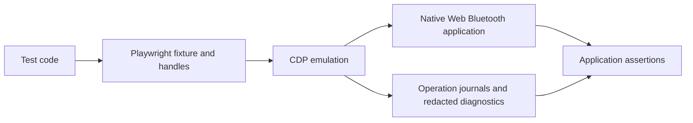

# GattLab architecture

GattLab runs deterministic Web Bluetooth application tests against Chromium's
virtual adapter. The packages divide protocol-independent values, browser
transport and Playwright fixture ownership.

## Package layering

```text
@gattlab/playwright   fixture, chooser, handles, journals, attachments
        │ public exports only
        ▼
@gattlab/cdp          sessions, protocol mapping, entities, pending operations
        │ public exports only
        ▼
@gattlab/core         normalized models, capabilities, errors, timeline
```

Dependencies point downward. Core imports no Playwright, CDP, browser globals or
Node filesystem APIs. Raw protocol commands and events belong only in the CDP
package and maintained protocol-contract tools. `pnpm boundaries:check` enforces
these boundaries; `pnpm packages:smoke` checks packed outputs and consumers.

## Runtime flow



A peripheral definition is normalized before browser effects. The entity registry
maps domain addresses and UUID paths to Chromium's opaque identifiers. Inbound
browser operations enter the pending-operation registry; response queues choose
one matching response, then the registry validates identity and current ownership
before sending it. Timeline events describe requested, pending, succeeded,
failed, cancelled, timed-out and late-completion outcomes without raw payloads.

The CDP factory owns domain lifetime, subscriptions, pending-work settlement,
artifact capture and session detachment. Playwright supplies process leases,
page ownership, successful default responses and outcome-aware attachment. It
does not duplicate protocol mappings. Every listener is armed before its trigger;
operations use explicit queues and deadlines rather than arbitrary sleeps.

## Invariants

- One active lab owns the adapter per Chromium process. BrowserContexts share
  it; simultaneous independent adapters require separate browser processes.
  Cleanup completes before the next lease starts.
- Chooser selection uses a normalized peripheral address. Empty or duplicate
  display names cannot identify a candidate; the application's device id is
  a separate opaque value.
- The service model supplies hierarchy and default chooser identity. Scan
  advertisements express separate visibility intent; the backend bootstraps
  identity when needed.
- `notify`/`indicate` requires descriptor `2902`. The native backend scripts
  subscription handshakes but does not inject notification payloads.
- Writes preserve deprecated, with-response and without-response intent.
  Application completion does not prove a scripted peripheral accepted a write.
- A response validates operation id, family, references and error names before
  mutation. There is one pending operation per entity/type; listener failures
  cancel their registration. No parallel correlation map bypasses the registry.
- A held Playwright connection enters the shared send queue when resumed.
  CDP still owns its pending deadline and notifies the handle if it is interrupted.
- A scripted disconnect restores the GATT hierarchy before resolving, retaining
  public handles and queues. A new chooser must open before explicit advertising.
- Confirmed adapter loss and uncertain partial model mutations permanently
  invalidate the lab. The first cause survives cleanup; there is no restart or
  transparent replay. Document changes alone are not proof of adapter loss.
- Public operation journals retain copied payloads in process. Automatic
  diagnostics apply bounded redaction/retention and do not replace a primary
  application failure. Timeline close is the final lifecycle action.
- Omitted advertisement appearance/transmit power is supplied as zero on the
  pinned browser and diagnosed; 0 dBm can be application-visible.

Details and exact error fields are in [API semantics](docs/api.md),
[protocol limitations](docs/protocol-limitations.md) and
[compatibility](docs/compatibility.md). These contracts move together with
runtime/type tests when behavior changes.

## Repository and validation

| Path                  | Purpose                                                          |
| --------------------- | ---------------------------------------------------------------- |
| `packages/core`       | Domain values, models, errors, backend contract and timeline     |
| `packages/cdp`        | Browser protocol adapter and lifecycle                           |
| `packages/playwright` | Fixture, public facade, handles and diagnostics                  |
| `examples`            | Native Vanilla, React and Blazor applications and their guides   |
| `tools`               | Boundary, packaging, documentation and installed-consumer checks |
| `docs`                | Consumer API, compatibility, limitations and troubleshooting     |

Pure unit/type tests prove domain behavior; fake sessions prove adapter logic;
real Chromium contracts establish browser behavior. Installed tarball consumers
check both supported TypeScript compilers and browser applications. Failed
attempts and resource cleanup remain visible. [Tool documentation](tools/README.md)
indexes commands; package-local guidance adds package-specific constraints.

Architectural changes require a concrete problem, tests and synchronized public
API/compatibility documentation. Reuse existing handler shapes until a real
requirement justifies another abstraction. Toolchain/protocol changes require
rerunning the real-browser checks on the new exact versions.
