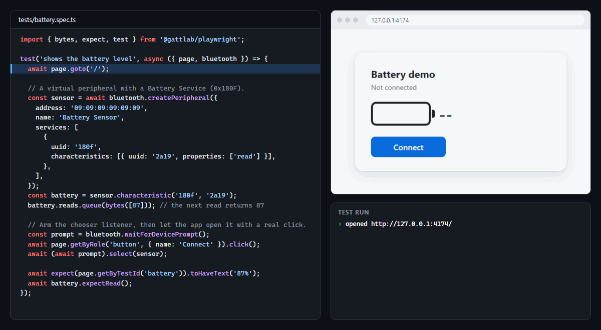
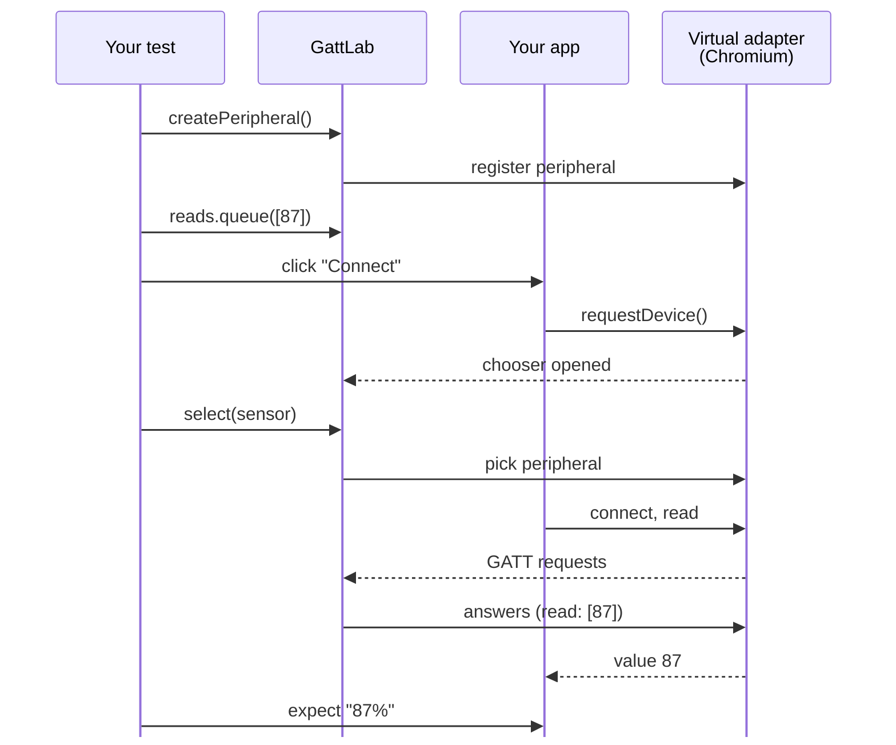

# GattLab

[](https://github.com/gattlab/gattlab/actions/workflows/validate.yml)
[](https://github.com/gattlab/gattlab/actions/workflows/security-audit.yml)
[](https://www.npmjs.com/package/@gattlab/playwright)

**Test Web Bluetooth apps with Playwright, without Bluetooth hardware.**

GattLab drives Chromium's built-in virtual Bluetooth adapter from Playwright
Test. Your test defines a virtual peripheral, selects it in the browser's real
device chooser, scripts its answers and asserts on what your application did.
The application keeps calling the real `navigator.bluetooth` API; nothing in
the page is patched or mocked.



> **Alpha:** the API can change before 1.0. Chromium only. Read the
> [limitations](#limitations) before adopting it.

## Example

```ts
import { bytes, expect, test } from '@gattlab/playwright';

test('shows the battery level', async ({ page, bluetooth }) => {
  await page.goto('/');

  // A virtual peripheral with a Battery Service (0x180F).
  const sensor = await bluetooth.createPeripheral({
    address: '09:09:09:09:09:09',
    name: 'Battery Sensor',
    services: [
      {
        uuid: '180f',
        characteristics: [{ uuid: '2a19', properties: ['read'] }],
      },
    ],
  });
  const battery = sensor.characteristic('180f', '2a19');
  battery.reads.queue(bytes([87])); // the next read returns 87

  // Arm the chooser listener, then let the app open it with a real click.
  const prompt = bluetooth.waitForDevicePrompt();
  await page.getByRole('button', { name: 'Connect' }).click();
  await (await prompt).select(sensor);

  await expect(page.getByTestId('battery')).toHaveText('87%');
  await battery.expectRead();
});
```

The [quick start](docs/quick-start.md) turns this into a runnable project with
a minimal application.

## Install

```sh
npm install --save-dev @gattlab/playwright@alpha @playwright/test
npx playwright install chromium
```

Enable Web Bluetooth on Linux in `playwright.config.ts`:

```ts
import { defineConfig } from '@playwright/test';

export default defineConfig({
  use: {
    browserName: 'chromium',
    launchOptions: {
      args:
        process.platform === 'linux' ? ['--enable-features=WebBluetooth'] : [],
    },
  },
});
```

Web Bluetooth requires a secure context, so open your application on
`https://` or `http://localhost` before the first `bluetooth` call.

## What a test can script

- The device chooser: select a peripheral or cancel the prompt.
- Connection, succeeding or failing with HCI errors, and service discovery.
- Characteristic and descriptor reads and writes: queued values, ATT errors and
  the recorded bytes and write type of every write.
- `startNotifications()` and `stopNotifications()` handshakes.
- Adapter state: `powered-on`, `powered-off` or `absent`.
- Disconnection and reconnection.
- Operation journals per handle, plus redacted diagnostics attached to failed
  Playwright tests.

## Notifications are not supported

GattLab **cannot send notification or indication values** to your application,
so `characteristicvaluechanged` never fires in a GattLab test. A test can answer
the subscription handshake (`startNotifications()` succeeds or fails with a
scripted ATT error), but cannot push a value afterwards.

This is a Chromium limitation. GattLab works through Chromium's experimental
`BluetoothEmulation` DevTools protocol domain, which has commands for
answering reads, writes and subscription requests but none for pushing a new
value to a subscribed characteristic. Until such a command exists, test the
code that handles `characteristicvaluechanged` separately, for example by
unit-testing the function that parses its value.

## Why not …

**Puppeteer's `page.bluetooth`?** As of Puppeteer 25.17 it emulates the adapter
and adds preconnected peripherals, and `page.waitForDevicePrompt()` drives the
chooser. It has no API for defining GATT services or answering reads, writes
and subscriptions, which is where most application logic lives.

**A mock of `navigator.bluetooth`?** A mock replaces the browser API, so tests
pass against the mock's assumptions. GattLab keeps Chromium's real
implementation in the loop: secure-context and user-gesture rules, the native
chooser, and the errors your code actually receives. For example, a scripted
`read-not-permitted` reaches the application as `NotSupportedError`.

## Limitations

- **Chromium only.** The validated setup is Playwright 1.65.1 with its bundled
  headless Chromium 159. Other Playwright versions from 1.65.0 run when the
  browser offers the required protocol domains, but are reported as
  `unverified`. See [compatibility](docs/compatibility.md).
- **No notification payloads** (see [above](#notifications-are-not-supported)).
- **One lab per browser process.** Playwright workers each launch their own
  browser, so parallel workers are fine. Browser contexts in one process share
  a single virtual adapter.
- **Reloading or navigating away can end the lab.** After a page that used Web
  Bluetooth is reloaded, navigated or closed, Chromium can drop the virtual
  adapter. GattLab then rejects further calls with a typed error instead of
  rebuilding state; start the next Bluetooth journey in a new test.
- **Not a radio simulator.** There is no RF timing, pairing, bonding, MTU
  negotiation or other lower-stack behavior.
- **Experimental browser protocol.** A Chromium update can change behavior,
  which is why validation pins exact versions.
- **Platforms.** CI runs on Ubuntu 24.04. Windows is not validated.

The complete list, with the observations behind each item, is in
[protocol and lifecycle limitations](docs/protocol-limitations.md).

## How it works

This is what happens when the [example](#example) above runs:



The fixture starts lazily on the first `bluetooth` call, answers every browser
request from your scripted queues (or a successful default), and cleans up the
adapter when the test ends. See [architecture](ARCHITECTURE.md) for the package
layering.

## Documentation

- [Quick start](docs/quick-start.md): a runnable first test
- [`@gattlab/playwright`](packages/playwright/README.md): fixture, handles and
  options
- [API semantics](docs/api.md) and [troubleshooting](docs/troubleshooting.md)
- [Protocol and lifecycle limitations](docs/protocol-limitations.md)
- [Compatibility and support](docs/compatibility.md)
- Sample applications tested through the installed packages:
  [Vanilla TypeScript](examples/vanilla-ts/README.md),
  [React](examples/react/README.md) and
  [Blazor WebAssembly](examples/blazor-wasm/README.md)

## Contributing

Bug reports, feature requests and minimal reproductions are welcome as issues.
Pull requests are not accepted yet; see [contributing](CONTRIBUTING.md).

To build and validate from source, use the pinned Node.js and pnpm versions from
`.node-version` and `package.json`:

```sh
pnpm install --frozen-lockfile
pnpm browser:install
pnpm validate
```

[Tool documentation](tools/README.md) describes what each validation command
checks.

## Trademark

The Bluetooth® word mark is a registered trademark owned by Bluetooth SIG,
Inc. GattLab uses the mark only to identify technology compatibility and is
not affiliated with or endorsed by Bluetooth SIG.

## License

[Apache-2.0](LICENSE)
